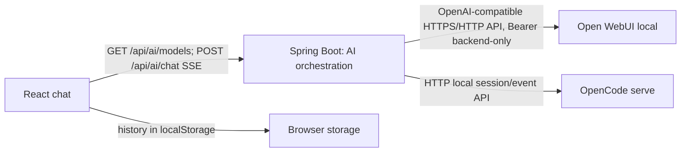

# Proyecto Agronom_IA

## Estado inicial

La bóveda contiene el proyecto `Agronom_IA` de Android Studio. Al inicio era una app Kotlin con Jetpack Compose, Material 3 y plantilla; no tenía API, cámara, selector, persistencia ni nota de proyecto. XAMPP tenía Apache y MySQL activos. La bóveda no tenía un repositorio Git; para cumplir los commits del proyecto se creó uno en la raíz de la bóveda, sin incluir las preferencias locales `.obsidian`.

## Arquitectura y decisiones

- UI Compose; estado y acciones asíncronas en un ViewModel con `StateFlow`.
- Selector del sistema para galería, intent `TakePicture` con URI de `FileProvider` para cámara. No se requieren permisos de cámara/almacenamiento para estos contratos del sistema.
- El recurso de galería se copia con límite de tamaño al espacio privado, se decodifica a resolución acotada y se convierte a JPEG. HEIF/HEIC depende del decodificador del dispositivo; el servidor recibe los bytes normalizados.
- PHP/Apache funciona como puente local; Android nunca habla con MySQL. En emulador, Android accede al host con `10.0.2.2`; en teléfono usa la IP LAN del PC.
- Imágenes en `C:\xampp\plant-images/<batch UUID>/<image UUID>.<ext>`, fuera del directorio público `htdocs`. MySQL guarda ruta relativa, UUID, lote, MIME, tamaño, dimensiones, estado mínimo y fecha. No se guardan BLOB.
- PHP valida otra vez conteo, tamaño, contenido detectado (`fileinfo`), dimensiones (`getimagesize`) y decodificación GD. El lote es atómico a nivel lógico: staging, transacción SQL, limpieza de archivos si falla.
- Flujo conversacional Android vigente: Pl@ntNet recibe las fotos y devuelve especies candidatas; la app envía solo ese contexto textual, el historial reciente y la pregunta a Spring (`/api/ai/chat`, SSE), el cual enruta al modelo seleccionado: DeepSeek V4.1 Flash Free o Qwen 3.6. Las imágenes nunca se envían al modelo conversacional móvil.
- HTTP y endpoint sin autenticación se limitan al desarrollo local en red privada; preparar TLS y autenticación antes de exponer.
- Android 17 (API 37), que usa el emulador actual y coincide con `targetSdk 37`, solicita `ACCESS_LOCAL_NETWORK` cuando usa Spring local o XAMPP. Pl@ntNet requiere permiso `INTERNET`.
- `SPRING_API_BASE_URL` se compila en la configuración debug del cliente, con valor por defecto `http://10.0.2.2:8081` para el emulador. OpenCode y Open WebUI, sus URLs y credenciales permanecen en Spring; OpenCode solo necesita estar activo en el PC donde corre Spring. La clave de Pl@ntNet se configura localmente con `PLANTNET_API_KEY`, pero actualmente se compila en el APK y debe trasladarse al backend antes de producción.

## Verificación de análisis IA (2026-10-13)

- La llamada directa al endpoint de inferencia de OpenCode para Space Bunny Free devolvió HTTP 403 `FreeTierError`. Se sustituyó por el servidor local OpenCode CLI, enlazado solo a `127.0.0.1:4096`; desde Android Emulator se accede vía `10.0.2.2:4096`.
- Flujo real probado en Pixel_8 AVD/API 37: imagen JPEG seleccionada y validada por la app; Pl@ntNet identificó `Hibiscus arnottianus`, familia Malvaceae, 40,2 % y alternativas. La app presentó la coincidencia como incierta y conservó las alternativas.
- Space Bunny recibió exclusivamente texto y devolvió riego, iluminación, toxicidad y advertencias; la primera respuesta tenía JSON/carácteres mezclados y fue rechazada. Un reintento correctivo produjo una guía JSON válida que se mostró en la app.
- Verificaciones del rediseño (2026-10-13): `:app:assembleDebug`, `:app:assembleRelease`, `:app:testDebugUnitTest` y `:app:connectedDebugAndroidTest` (15 pruebas instrumentadas, todas correctas).
- Para volver a analizar, mantener `opencode serve --hostname 127.0.0.1 --port 4096` activo. Rotar las claves compartidas durante la configuración; Pl@ntNet se compila en el APK local.

## API y almacenamiento

`POST /agronomia-api/api/images.php` acepta `photos[]`, máximo cinco, JPEG/PNG/WebP decodificables hasta 15 MiB cada uno. Devuelve `201` con `success`, `batch_id` y rutas relativas solo tras escribir y confirmar todas las filas. La carpeta local continúa siendo `C:\xampp\plant-images`; MySQL conserva metadatos y rutas, no las imágenes.

El análisis ya no usa `api/analyze.php` (endpoint anterior retirado del proyecto y de XAMPP). Pl@ntNet recibe multipart JPEG en `POST https://my-api.plantnet.org/v2/identify/all?api-key=...` (`lang=es`, 3 candidatos). Android llama DeepSeek por OpenCode CLI local (`opencode serve --hostname 127.0.0.1 --port 4096`, modelo `opencode/deepseek-v4.1-flash-free`). Android Emulator accede a `10.0.2.2:4096`. `OPENCODE_SERVER_BASE_URL` puede sobrescribir la URL base; Pl@ntNet requiere `PLANTNET_API_KEY` en propiedades locales de Gradle/variable de entorno. Ninguna clave debe guardarse en esta nota o en Git.

## Chat Android y Skill botánica

- UI actual: `app/src/main/java/com/correa/agronom_ia/PlantChatScreen.kt` ofrece barra de acciones, lista desplazable de mensajes, bienvenida con preguntas sugeridas y composer con texto, adjuntos, cámara y envío. El estado ocupado bloquea acciones repetidas; los errores quedan junto al composer con reintento.
- `PlantPhotoViewModel.kt` persiste hasta 60 mensajes y los metadatos mínimos de análisis en `SharedPreferences` privadas de la app. Se conservan nombres de fotos en el historial, no se guardan en la nube. Una conversación nueva limpia el historial y selección local.
- [[Agronom_IA/.agents/skills/botany-assistant/SKILL|Skill botánica]] es la fuente única versionada. Gradle la empaqueta como asset desde `Agronom_IA/.agents/skills`; `BotanyInstructionsRepository` elimina el frontmatter `SKILL.md` y pasa su cuerpo como instrucción `system` a cada solicitud OpenCode. La app añade en el mensaje del usuario el contexto actual de Pl@ntNet y hasta 12 turnos anteriores por separado. El modelo no recibe imágenes.
- El formato de respuesta es Markdown breve para chat, no JSON. El parser valida cuerpo no vacío, longitud y texto legible; una salida no válida activa un único intento de corrección. La prueba instrumentada comprueba que la Skill está realmente empaquetada y disponible.
- Prueba real del chat sin identificación: el modelo devolvió una respuesta en español con fragmentos CJK y nombres comerciales no solicitados. Se añadió validación para rechazar caracteres CJK salvo que el usuario use ese alfabeto; la app reintentó y, al persistir una salida ilegible, dejó el error visible con acción **Reintentar**. Esto evita mostrar texto malformado, pero la calidad factual y lingüística de Space Bunny Free sigue siendo variable y no queda garantizada por la app.
- No se añadieron bibliotecas ni se migró el tema. Se conservan Compose Material 3, colores botánicos claro/oscuro, selector, cámara y flujo de subida XAMPP/MySQL.

## Pruebas y pendientes

Las verificaciones históricas de XAMPP/MySQL anotadas abajo son del bloque anterior. El bloque de integración previa de Space Bunny se verificó con una imagen real en Pixel_8 AVD/API 37, junto a Pl@ntNet/OpenCode. Para el rediseño: ensamblados debug/release y pruebas unitarias completados; 15 pruebas instrumentadas completadas en Pixel_8 AVD/API 37. También se lanzó la app compilada en el emulador y se envió una pregunta genérica real al servidor OpenCode; la salida ilegible fue detectada, se reintentó y la interfaz mostró el error con opción de reintento. La generación real requiere conexión a Internet, Pl@ntNet y el `opencode serve` local activo. La disponibilidad y calidad de Space Bunny Free pueden cambiar.

- XAMPP: esquema importado, cuenta API de mínimo privilegio, endpoint de imágenes desplegado y carpeta con ACL restringida; PHP tiene GD, WebP y mysqli.
- Smoke tests previos del backend: GET responde 405, texto disfrazado de JPEG 415, lote de cinco imágenes 201 y lote de seis 422; se limpió el lote de prueba.
- En el emulador API 37 se probó la carga a Apache/MySQL y la concesión de permiso de red local. La captura real desde cámara aún requiere verificación manual.
- Para usar teléfono físico, el firewall aún necesita regla TCP entrante puerto 80 para perfil Private y LocalSubnet: `New-NetFirewallRule -DisplayName "Agronomia local XAMPP API" -Direction Inbound -Action Allow -Protocol TCP -LocalPort 80 -Profile Private -RemoteAddress LocalSubnet`.

## Migración progresiva del backend a Spring Boot (2026-10-13)

### Inspección e inventario

- El repositorio versionado contiene un único endpoint PHP: `POST /agronomia-api/api/images.php`. No se encontraron rutas de usuarios, login, administración, análisis de IA ni otros módulos. No hay roles ni autenticación. React no forma parte del proyecto.
- Android usa `photos[]`, entre 1 y 5 imágenes, y espera `201 { success, batch_id, images: [{ id, path, mime_type, size }] }`. El endpoint PHP acepta JPEG/PNG/WebP decodificables, 15 MiB por foto y 4096 px máximos; los guarda fuera de `htdocs` y registra metadatos en MySQL.
- MariaDB 10.4.32 de XAMPP escucha localmente en 3306. `SHOW CREATE TABLE plant_images` coincide con `backend/schema.sql`; la tabla InnoDB no guarda BLOB y no tiene relaciones. La cuenta de API carece de permiso para consultar el DDL, por eso se verificó con consulta local solo lectura. No se modificó la base.
- Apache no estaba escuchando en puerto 80 al revisar este bloque, así que el PHP desplegado no se verificó por HTTP ni se reemplazó.

### Arquitectura migrada

- Nuevo módulo `Agronom_IA/backend-spring`: Spring Boot 3.5.16, código Java con release 17 (JDK 24 local), MariaDB JDBC y monolito modular bajo `com.agronomia.backend.images`.
- `POST /agronomia-api/api/images.php` conserva el path, multipart `photos[]`, DTO exitoso y límites del cliente. Acepta JPEG/PNG/WebP detectados por firma, comprueba decodificación y dimensiones, guarda por UUID en `C:\xampp\plant-images` y registra filas JDBC con `TransactionTemplate`. Si falla la transacción se limpia el directorio del lote.
- Se eligió `JdbcTemplate`, no JPA/Hibernate: solo se inserta en una tabla simple sin relaciones ni lecturas; SQL explícito conserva el esquema legado. No se agrega Flyway porque no hay cambio de esquema. El DDL se deja intacto.
- La API anterior no tenía autenticación; no se inventó un mecanismo que rompa el cliente. Spring escucha por defecto en `127.0.0.1:8081`. No exponerlo a LAN/Internet sin TLS, autenticación y firewall. Los secretos salen de variables de entorno.
- PHP permanece como fallback en puerto 80; Android se puede dirigir al mismo path en Spring con `PLANT_API_BASE_URL=http://10.0.2.2:8081/agronomia-api`. El cambio del APK queda pendiente de aceptación end-to-end desde el emulador. PHP solo se retirará tras verificar el cliente.

### Pruebas y pendientes

- Pruebas del backend: `mvn test` en `Agronom_IA/backend-spring`; 14 correctas con H2 en memoria. Cubren contrato HTTP, 1/5/6 fotos, firma/MIME, JPEG/PNG/WebP, GIF, corrupción y rollback tras falla después de un INSERT con limpieza de archivos.
- Integración real contra MariaDB/XAMPP usando la base nueva `agronomia_spring_migration_test_20261013`: GET 405 JSON; lote de cinco JPEG 201 con cinco filas/archivos; seis 422; GIF con MIME/extensión falsos 415. Los errores no añadieron filas. No se modificó la base `agronomia`.
- La base aislada y cinco imágenes sintéticas permanecen en `%TEMP%\agronomia-spring-mariadb-test-images`; la herramienta rechazó la limpieza destructiva, así que quedan disponibles para inspección.
- Pendiente: prueba de carga desde Android Emulator al host Spring en `10.0.2.2:8081`; el valor predeterminado móvil continúa apuntando a PHP. La configuración XAMPP se revisó sin copiar secretos.
- Riesgo operacional: un cierre abrupto del proceso entre la escritura de archivos y commit puede dejar una carpeta huérfana; requiere reconciliación periódica antes de operación de larga duración.
- Configuración, inventario detallado de endpoints, estructura, seguridad y ejecución: [[Agronom_IA/backend-spring/README]].
## Commits

- `635316e` — Implementa flujo móvil de imágenes y análisis.
- `e6892f0` — Añade API PHP, validación y persistencia MySQL.
- `ef6ed26` — Documenta instalación local, IA y verificaciones.
- `784fc3e` — Incluye archivos base del proyecto Android.

El repositorio está en la raíz de la bóveda. `.obsidian`, `Bienvenido.md`, `local.properties`, compilaciones y archivos de IDE quedan fuera de Git.

## Chat web multi-modelo (2026-10-19)

### Arquitectura y flujo

Se agregó `Agronom_IA/frontend-web` como cliente React + TypeScript independiente y empacable por Spring Boot. No existía frontend web antes de este cambio; no hay frontend administrativo ni se agregaron módulos multiagente a la aplicación.

El backend es el único que resuelve el `providerId` mediante una lista permitida; el cliente no puede enviar URL, modelo arbitrario ni credencial. `GET /api/ai/models` devuelve identificador, nombre, proveedor y disponibilidad. `POST /api/ai/chat` transmite eventos SSE `delta`, `done` o `error`; cancelar la generación cierra la petición y señala cancelación al proveedor. Los mensajes anteriores permanecen en la conversación del navegador y se reenvían como texto contextual en cada solicitud. Cambiar el modelo afecta los turnos siguientes; no implica memoria compartida entre OpenCode y Open WebUI. La conversación web no se persiste en MySQL.

`qwen-local` llama a Open WebUI con `GET /api/models` para comprobar el ID autorizado y `POST /api/chat/completions` para la generación progresiva. Las instrucciones botánicas se obtienen del `SKILL.md` ya existente, empaquetado como recurso de Spring, manteniendo una sola fuente de instrucciones. Space Bunny conserva el ID `space-bunny-free` y usa el servidor OpenCode. No se tocó el flujo de IA del cliente Android ni el esquema MySQL de imágenes.

El diagnóstico de Qwen confirmó que el cuerpo del último mensaje sí llega a Open WebUI y que el modelo devuelve texto por SSE. La respuesta genérica repetida venía de las instrucciones compartidas, que lo hacían identificarse como Space Bunny; la Skill ahora exige contestar la solicitud actual, evitar saludos repetidos y no atribuirse el proveedor seleccionado.

### Interfaz

La aplicación web ofrece conversaciones locales recientes, búsqueda y borrado, sidebar contraíble y menú móvil, tema claro/oscuro, selector visible, bienvenida con consultas de ejemplo, composer con crecimiento automático, envío Enter/Shift+Enter, Markdown/GFM, bloques de código, indicadores de generación, cancelar, error/reintentar y diseño adaptable. El historial se guarda en `localStorage`, únicamente en ese navegador. No se muestran acciones de adjuntos en la web porque no están integradas en este flujo. El renderizado Markdown se carga de forma diferida.

### Configuración

Variables del backend (nunca del browser): `OPENWEBUI_BASE_URL`, `OPENWEBUI_API_KEY`, `OPENWEBUI_MODEL`, `OPENCODE_SERVER_BASE_URL`, `OPENCODE_SERVER_USERNAME`, `OPENCODE_SERVER_PASSWORD`, `OPENCODE_MODEL_ID`, `AI_CHAT_CONNECT_TIMEOUT`, `AI_CHAT_READ_TIMEOUT`. Un ejemplo sin credenciales reales está en [[Agronom_IA/backend-spring/application-example.env]]. Spring no carga `.env` automáticamente; define estas variables en el proceso del backend. La clave de desarrollo se configuró en el entorno de usuario de Windows y no se incorporó al repo. Como fue compartida en el chat, se recomienda rotarla y volver a definirla en el entorno local.

Para ejecutar en desarrollo: `npm install` y `npm run dev` en `Agronom_IA/frontend-web`; Vite usa proxy a Spring `127.0.0.1:8081`. Para servir desde Spring, ejecuta `npm run build` y compila el módulo backend, que incluye `frontend-web/dist`. El backend sigue usando el perfil de base de datos existente; el perfil `test` usa H2 y no modifica MySQL.

### Verificaciones y límites observados

- UI real abierta en `http://127.0.0.1:8081/`: el navegador mostró chat vacío, selector, opción Qwen disponible y Space Bunny deshabilitado por indisponibilidad.
- Open WebUI local real autenticado: catálogo identificó `Qwen/Qwen3.6-35B-A3B-FP8`; solicitud de chat atravesó Spring y produjo HTTP 200 con ocho deltas SSE. Se comprobó que el catálogo no contiene la credencial.
- OpenCode local respondió health y lista de proveedores, pero no anunció `space-bunny-free`; por seguridad no se elige otro modelo de OpenCode. La opción queda deshabilitada hasta que ese ID exacto esté disponible.
- Se reprodujo una llamada OpenCode explícita y el runtime devolvió `ProviderModelNotFoundError` para `opencode/space-bunny-free`. OpenCode 1.18.34 fue actualizado a 1.19.3, que sigue sin publicar el ID; el servidor local está sano pero Space Bunny queda deshabilitado. La configuración global fue restaurada sin cambios persistentes.
- Spring: 20 pruebas ejecutadas en `mvn clean test package`, sin fallos; incluye descubrimiento/modelo, streaming simulado, errores 429 y HTTP 400/503, validaciones y persistencia de imágenes. Frontend: 4 pruebas y build TypeScript/Vite pasan; `npm audit` informa cero vulnerabilidades.
- No se verificó renderizado visual automatizado en distintos tamaños, cámara, pruebas físicas ni integración visual de Space Bunny porque su modelo no está disponible. El flujo real de Open WebUI se verificó de extremo a extremo.
- La auditoría de arquitectura delegada a OpenCode se realizó como lectura solamente con modelo `opencode/big-pickle`; corroboró ausencia previa de web y de chat en Spring. Codex revisó el resultado.

Ver también [[Agronom_IA/frontend-web/README]] y [[Agronom_IA/backend-spring/README]].

## Análisis de imágenes en el chat web (2026-10-19)

Esta sección actualiza el estado del chat web descrito arriba. El alcance se limita a `frontend-web` y al módulo de chat de `backend-spring`; no se modificó el cliente Android, la API de imágenes existente ni MySQL.

### Entrada, validación y persistencia local

- El usuario puede elegir archivos, arrastrarlos a la ventana del chat o pegarlos con Ctrl/Cmd + V. El pegado normal de texto se conserva; si vienen texto e imagen en el mismo evento, se insertan ambos.
- Un validador común inspecciona firma binaria, MIME declarado cuando es de tipo imagen, decodificación y dimensiones antes de preparar un JPEG de miniatura de 320 px. En UI y backend se limitan cinco imágenes por mensaje (política de lotes existente), 15 MiB por imagen (límite existente en el backend), 50 MiB total en el contexto enviado (derivado del máximo HTTP 80 MB y el aumento aproximado de Base64 4/3) y dimensiones entre 16 y 4096 px. Se admiten JPEG, PNG, WebP y GIF; HEIF/HEIC y SVG no se admiten en este flujo.
- Las miniaturas preservan la vista del historial en localStorage. Los originales se guardan en IndexedDB del navegador, se reenvían como imágenes reales en turnos posteriores y se limpian cuando se borra la conversación. El almacenamiento es local al navegador; no usa MySQL ni una ruta del PC.
- Los bytes viajan como Base64 en el JSON privado entre navegador y Spring, luego como data URL según los contratos del proveedor. No se guardan de forma permanente en el backend ni se imprimen en logs.

### Compatibilidad de proveedores

`GET /api/ai/models` ahora incluye `supportsImages` e información de incompatibilidad. DeepSeek se habilita solo si OpenCode anuncia `capabilities.input.image`; Qwen solo si Open WebUI anuncia `info.meta.capabilities.vision`. En la configuración local revisada ambos valores eran `true`. DeepSeek recibe partes `file` con URL `data:` por `prompt_async`; Qwen recibe el formato OpenAI-compatible `content` con bloques `image_url`. El texto y el historial siguen pasando por el mismo endpoint SSE y al proveedor elegido por la conversación. Un modelo sin la capacidad declarada conserva el chat de texto y deshabilita adjuntos.

### Comprobaciones realizadas

- `mvn test`: 25 pruebas pasan, incluyendo validación de bytes, MIME falseado, corrupción, límites y contrato de Open WebUI.
- `npm test -- --run`: suite de Vitest pasa con detección de firmas, rechazo MIME falso/archivo vacío y petición con datos reales de imagen.
- `npm run build`: TypeScript y Vite construyen el cliente.
- Con Spring en perfil de pruebas y los servicios locales activos, `GET /api/ai/models` anunció DeepSeek y Qwen disponibles con imágenes. Una misma imagen sintética con una maceta azul se envió a cada proveedor por Spring; ambos contestaron “Azul” mediante SSE (HTTP 200). Esto confirma la transmisión visual de esa prueba, no la certeza de identificaciones de plantas en general.
- La interfaz se abrió en navegador local y se inspeccionó el árbol accesible: saludo Qwen, selector, botón de adjuntar y estados estaban presentes. No se automatizaron las acciones de file chooser del SO, arrastrar ni pegar en navegador; se verificaron por compilación y revisión de código, no por prueba UI automatizada.
- Al borrar un chat se borran también sus originales de IndexedDB. No se modificó ninguna tabla ni se persistieron imágenes en el servidor.

Detalle de contratos y límites: [[Agronom_IA/backend-spring/README]].

## Sustitución de Space Bunny por DeepSeek (2026-10-19)

Este apartado refleja el estado vigente y prevalece sobre los registros históricos de Space Bunny Free que aparecen en las secciones anteriores.

### Selección y flujo actual

- El chat web consulta `GET /api/ai/models`; Spring expone dos opciones permitidas: `deepseek-opencode` y `qwen-local`. El cliente solo envía el identificador lógico elegido; OpenCode y Open WebUI, las URLs y sus credenciales permanecen detrás de Spring.
- `deepseek-opencode` usa el adaptador `OpenCodeDeepSeekProvider`, `OPENCODE_SERVER_BASE_URL` y el servidor OpenCode existente. `OPENCODE_MODEL_ID` permite sobrescribir el ID (por defecto `deepseek-v4.1-flash-free`); el proveedor de OpenCode es `opencode`.
- `qwen-local` conserva el proveedor Open WebUI y el identificador configurado `Qwen/Qwen3.6-35B-A3B-FP8`; no se cambió su configuración ni su adaptador.
- El historial del chat web permanece en localStorage y se reenvía como contexto por turno. Al recuperar conversaciones antiguas, el ID lógico `space-bunny` se adapta a `deepseek-opencode`; los mensajes y el historial no se reemplazan. No hay cambios de esquema MySQL.
- El backend devuelve el saludo correspondiente como metadato del modelo. Solo se presenta en la vista vacía; no se añade a la conversación ni se envía al proveedor. Cambiar modelo conserva el historial.

### Identificador verificado y configuración

El catálogo de OpenCode CLI 1.19.3 anunció `opencode/deepseek-v4.1-flash-free`. La documentación oficial publica el ID corto `deepseek-v4.1-flash-free` ([catálogo OpenCode](https://opencode.ai/v2/docs/console/models/)). El 2026-10-19, una ejecución directa y otra adjunta al servidor OpenCode produjeron texto. La validación de extremo a extremo desde Spring también pasó: el endpoint `POST /api/ai/chat` devolvió HTTP 200, deltas SSE y `done` con `providerId=deepseek-opencode`; Qwen devolvió HTTP 200, deltas y `done` por Open WebUI. `GET /api/ai/models` marcó ambos modelos disponibles.

Spring debe ejecutarse en el mismo equipo que `opencode serve` o alcanzar su URL configurada. En emulador Android el host es `10.0.2.2`, pero este backend web resuelve OpenCode desde la máquina donde corre Spring. El servicio anuncia el modelo en catálogo solo si OpenCode reporta el servidor saludable, proveedor conectado y modelo presente. MySQL no guarda conversaciones web.

### Archivos y verificación

Cambios: adaptador OpenCode, catálogo/DTO Spring, `application.yml`, catálogo consumido por React, pantalla de bienvenida, migración de lectura del ID anterior, pruebas, README de Spring/app y esta nota. El cliente Android se actualizó para pedir el mismo ID de modelo a su OpenCode local. No se incluyeron secretos ni se añadieron dependencias.

Pruebas de este cambio: `mvn clean test package` (22 pruebas, 0 fallidas), `npm test -- --run` (4 pruebas), `npm run build`, `:app:assembleDebug` y `:app:testDebugUnitTest` terminaron correctamente. Se probaron en vivo catálogo y generación SSE para DeepSeek y Qwen. La prueba de modelo identificó el problema real del adaptador: OpenCode 1.19.3 anida los eventos SSE bajo `payload`; al no desenvolverlos, Spring descartaba `type` y quedaba esperando indefinidamente. Ahora se acepta el formato actual y el anterior, y se detecta el estado idle actual. No se cambiaron MySQL ni la configuración de Qwen. No se realizó prueba visual automatizada en varios tamaños.

## Integración multi-modelo en Android (2026-10-19)

Este apartado actualiza el flujo móvil anterior de OpenCode directo. La app Kotlin mantiene Compose/MVVM, la selección/captura de hasta cinco imágenes, validación y almacenamiento privado, identificación mediante Pl@ntNet y guardado opcional de imágenes mediante el endpoint XAMPP. Solo cambia el destino de las solicitudes conversacionales.

### Arquitectura y selección

- `AiChatApi.kt` es el cliente móvil común para Spring. Consulta `GET /api/ai/models` y envía `POST /api/ai/chat` con `providerId` lógico e historial mediante SSE. No contiene URL del proveedor, clave Open WebUI ni credenciales de OpenCode.
- Los únicos IDs seleccionables son `deepseek-opencode` y `qwen-local`. Spring mantiene sus adaptadores actuales e IDs técnicos: `deepseek-v4.1-flash-free` y `Qwen/Qwen3.6-35B-A3B-FP8`.
- La disponibilidad visible procede del catálogo real de Spring; si el catálogo no se pudo consultar, la app no afirma que un proveedor esté disponible. El usuario puede elegir cualquiera y recibe el error de backend pertinente si ese proveedor está caído; no hay cambio automático al otro.
- La preferencia se guarda en `SharedPreferences`. Cada mensaje nuevo guarda su `providerId`; los mensajes de historial anteriores sin esta propiedad se interpretan como DeepSeek, el único modelo móvil que existía. Cambiar el modelo conserva los mensajes. Reintentar vuelve a usar el modelo del mensaje fallido.
- El saludo que devuelve el catálogo solo se presenta en la pantalla vacía. No se persiste como mensaje ni se envía al modelo. Cambiar de proveedor con historial no altera etiquetas anteriores.
- Pl@ntNet sigue recibiendo las imágenes de la app. La identificación se incorpora como texto a la consulta conversacional seleccionada; Android no envía las fotos al endpoint multimodal del chat aunque el catálogo de proveedor informe compatibilidad de visión. El guardado opcional de imágenes PHP/XAMPP/MySQL no cambia.
- Spring añade la Skill botánica como instrucción del sistema y construye la petición al proveedor. No hay cambios de esquema ni de base de datos.

### Red local y ejecución

El valor de desarrollo de `SPRING_API_BASE_URL` es `http://10.0.2.2:8081`, la dirección del host vista desde Android Emulator. Puede cambiarse en `%USERPROFILE%\.gradle\gradle.properties` o como propiedad al ejecutar Gradle, sin almacenar secretos:

~~~properties
SPRING_API_BASE_URL=http://10.0.2.2:8081
~~~

Para un teléfono físico, usar `http://IP_LAN_DEL_PC:8081`, iniciar Spring con `SERVER_ADDRESS=0.0.0.0` y permitir el puerto 8081 únicamente en el perfil privado del firewall. Mantener OpenCode en loopback es suficiente: Spring se conecta desde el mismo PC. Open WebUI debe ser accesible desde ese backend. La configuración de desarrollo Android permite HTTP; `release` lo bloquea. Spring local aún no autentica clientes, por lo que el puerto debe limitarse a la red local.

### Archivos y comprobaciones

Cambios Android: `app/build.gradle.kts`, `AiChatApi.kt`, `PlantAnalysisApi.kt`, `PlantPhotoViewModel.kt`, `PlantChatScreen.kt`, `MainActivity.kt` y pruebas instrumentadas. Se eliminó el antiguo cliente directo OpenCode y el cargador de Skill del APK; Spring ya añade la instrucción botánica. No se agregó dependencia. La documentación base de Android quedó actualizada en [[Agronom_IA/README]].

Verificación ejecutada en este entorno: `:app:assembleDebug`, `:app:testDebugUnitTest`, `:app:compileDebugAndroidTestKotlin`, `:app:connectedDebugAndroidTest` (15/15 en Pixel_8 API 37) y `:app:installDebug` pasaron. `GET /api/ai/models` fue accesible desde el emulador vía `10.0.2.2:8081` y mostró ambos proveedores disponibles. Desde la app instalada se seleccionó Qwen, que devolvió una respuesta real; se cambió luego a DeepSeek, que también respondió. El historial conservó las etiquetas originales de Qwen y DeepSeek. Además, desde el host, ambos POST reales a `/api/ai/chat` emitieron deltas SSE y `done`. Se revisó visualmente el estado vacío en Pixel_8; no se probó un teléfono físico ni otros tamaños/orientaciones. No se modificaron backend, Qwen, OpenCode, Pl@ntNet, PHP, MySQL ni el esquema.
