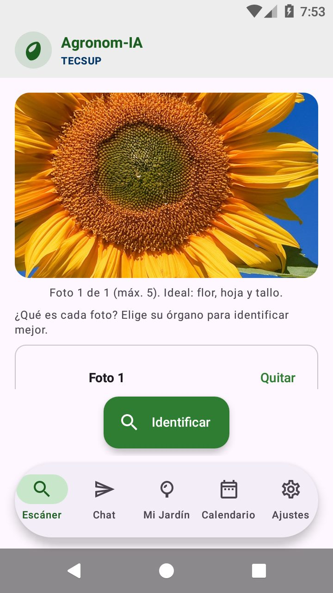
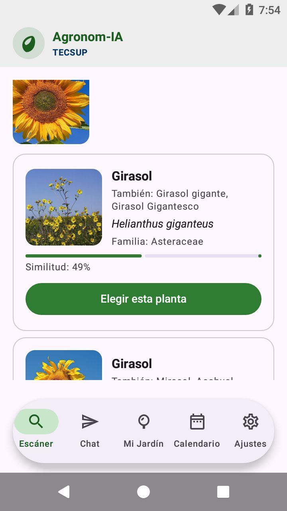
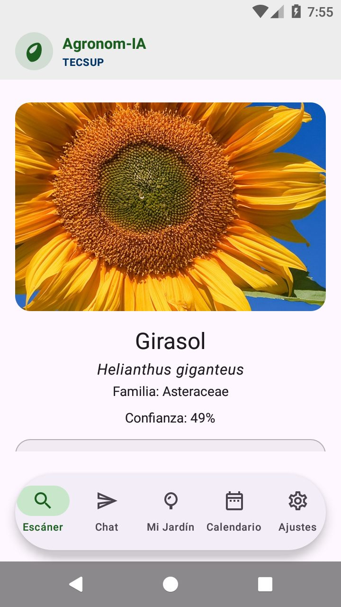

# Agronom-IA

Asistente botánico para agricultores: se sube una foto de una planta, se
identifica la especie y se devuelve una **ficha clara en español** (luz, riego,
suelo, clima, floración, usos y cuidados) con glosario y materiales. Después se
puede **conversar** con un asistente que conoce la planta detectada.

El trabajo pesado (Pl@ntNet + Gemini con *skills*) lo hace el **backend de
usuario en Django**; la app móvil y la web de usuario solo envían fotos y
mensajes. El panel de administración es un **servicio aparte en Spring Boot**
que comparte la misma base de datos MySQL.

## Arquitectura

```
                    ┌──────────────────────────┐
   App Android ────►│                          │
   (Kotlin/Compose) │  Django (servicio de      │
                    │  usuario) :8000           │──► Pl@ntNet
   Web de usuario ─►│  identifica, ficha, chat  │──► Gemini (skills)
   (React) :5174    │  login + roles            │
                    └────────────┬─────────────┘
                                 │  MySQL (XAMPP) :3306
                                 │  base `agronomia`
                    ┌────────────┴─────────────┐
                    │  Spring Boot (servicio    │
   Panel admin ────►│  de administración) :8081 │
   (React) :5173    │  usuarios, plantas, chat  │
                    └──────────────────────────┘
```

- **App Android** (`app/`): Kotlin + Jetpack Compose, paquete
  `com.agronomia`. Escáner, ficha y chat; Mi Jardín y Calendario están en
  construcción (pantallas de aviso).
- **Backend Django** (`backend-django/`): API del usuario. Ejecuta el pipeline
  de identificación y carga las *skills* en tiempo de ejecución desde
  `backend-django/skills/`.
- **Backend Spring Boot** (`backend-spring/`): API del administrador. Valida
  las mismas cuentas de Django y emite su propio token; nunca toca las claves
  de IA.
- **Web de usuario** (`web-user/`): React. Escáner, ficha, glosario, jardín y
  chat flotante.
- **Panel de administración** (`web-admin/`): React. Resumen, usuarios, plantas
  y chat.

### Puertos

| Servicio | URL |
|---|---|
| Django (usuario) | http://127.0.0.1:8000 |
| Spring Boot (admin) | http://127.0.0.1:8081 |
| Web de usuario | http://localhost:5174 |
| Panel de administración | http://localhost:5173 |
| MySQL (XAMPP) | 127.0.0.1:3306 |

### Capturas de la app móvil

| Escáner | Especies parecidas | Ficha |
|---|---|---|
|  |  |  |

## Puesta en marcha

### 1. Base de datos

1. Abre XAMPP y arranca **MySQL**.
2. Crea la base y el usuario con `docs/sql/agronomia.sql` (o phpMyAdmin).
3. Las tablas las crea Django con `migrate`; `plant_images` ya existe en el
   esquema original y se mantiene.

### 2. Backend Django (servicio de usuario)

```powershell
cd backend-django
py -m venv .venv
.\.venv\Scripts\Activate.ps1
pip install -r requirements.txt
Copy-Item .env.example .env    # completa tus claves
py manage.py migrate
py manage.py seed_demo         # usuarios de demo
py manage.py runserver 0.0.0.0:8000
```

Las claves (`AI_API_KEY`, `PLANTNET_API_KEY`) van **solo** en `.env`, que
está ignorado por Git. La app y las webs nunca reciben esas claves. Sin MySQL
se puede trabajar con SQLite: `$env:USE_SQLITE=1`.

Detalle: [`backend-django/README.md`](backend-django/README.md).

### 3. Backend Spring Boot (servicio de administración)

```powershell
cd backend-spring
.\mvnw.cmd -q -DskipTests package
$env:DB_USERNAME="agronomia_api"; $env:DB_PASSWORD="..."
$env:ADMIN_TOKEN_SECRET="un-secreto-largo"
java -jar target/agronomia-backend-0.1.0-SNAPSHOT.jar
```

Detalle: [`backend-spring/README.md`](backend-spring/README.md).

### 4. Webs

```powershell
cd web-user ; npm install ; npm run dev    # http://localhost:5174
cd web-admin; npm install ; npm run dev    # http://localhost:5173
```

Detalle: [`web-user/README.md`](web-user/README.md) y
[`web-admin/README.md`](web-admin/README.md).

### 5. App Android

Crea `local.properties` con la ruta del SDK y la URL del backend:

```properties
sdk.dir=C\:\\Android\\Sdk
BACKEND_BASE_URL=http://10.0.2.2:8000/
```

Luego `.\gradlew.bat installDebug`. El emulador llega al PC con `10.0.2.2`.

## Cuentas de demo

Se crean con `py manage.py seed_demo` (solo desarrollo):

| Usuario | Contraseña | Rol | Entra en |
|---|---|---|---|
| `admin` | `Admin12345` | admin | panel de administración |
| `agricultor` | `Campo12345` | user | app móvil y web de usuario |

El panel rechaza las cuentas con rol `user` (403) y el backend de usuario no
deja que un usuario se asigne el rol `admin` al registrarse.

## Cómo funciona la identificación

1. **Pl@ntNet** devuelve la especie y su ficha. La confianza decide el caso:
   - `< 20 %` → no identificada: se explica y se dan consejos de foto.
   - `20 – 49 %` → ambigua: se muestran las candidatas; al elegir una, se
     genera la ficha reutilizando la corrida de Pl@ntNet.
   - `≥ 50 %` → identificada: se genera la ficha directamente.
2. **Gemini** trabaja con las *skills* de `backend-django/skills/`
   (refinar consulta, una por categoría, glosario y materiales). Se hacen 4
   llamadas en lote con reintento ante 429. Si no conoce la especie, la ficha
   no se inventa: se avisa con el estado `insufficient`; si solo falta una
   categoría, se muestra un texto de respaldo con pautas generales.
3. El **chat** recibe el contexto de la planta (nombre, familia, similitud) y
   responde en español con formato Markdown.

## Documentación

- [`docs/CONFIG-IA.md`](docs/CONFIG-IA.md): pipeline de IA y skills.
- [`docs/HU-07.md`](docs/HU-07.md): trazabilidad de la historia de cuidado de
  la planta (tareas del sprint, estados y pruebas).
- [`docs/sql/agronomia.sql`](docs/sql/agronomia.sql): base de datos compartida.
- [`backend-django/README.md`](backend-django/README.md): endpoints del usuario.
- [`backend-spring/README.md`](backend-spring/README.md): endpoints del admin.
- [`web-user/README.md`](web-user/README.md) y
  [`web-admin/README.md`](web-admin/README.md): las dos webs.

## Seguridad

- Ninguna clave vive en el repositorio: Django usa `backend-django/.env`
  (ignorado por Git). `local.properties.example` y `.env.example` solo muestran
  los nombres de las variables.
- La app Android **no lleva claves**: solo conoce la URL de Django, que es
  quien habla con Pl@ntNet y Gemini.
- El servicio de administración usa un token HMAC firmado (8 h por defecto) y
  comprueba el rol en cada petición.
- El autorregistro crea siempre cuentas con rol `user`; el rol `admin` solo se
  asigna desde el servidor.
- Comentarios del código, mensajes de interfaz y documentación en español.

## Estado

Funcionando de punta a punta sobre MySQL/XAMPP: app móvil, web de usuario,
backend Django, backend Spring y panel de administración. Las pruebas se
hicieron con fotos de girasol (identificada), una foto recortada (ambigua con
candidatas) y una imagen gris (no identificada).
