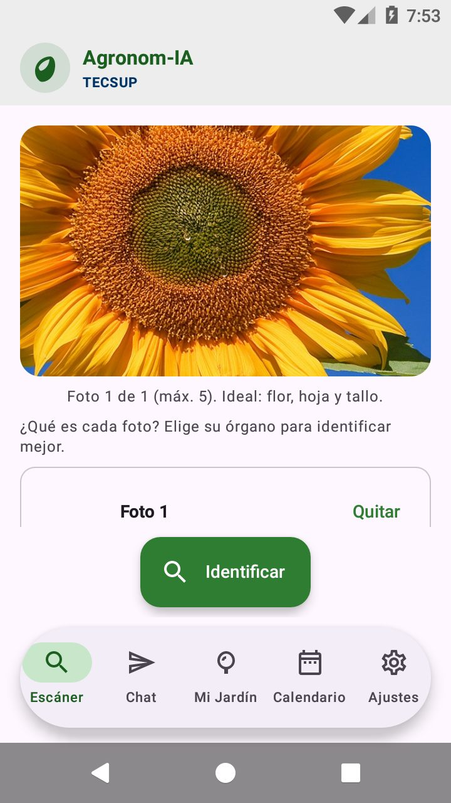
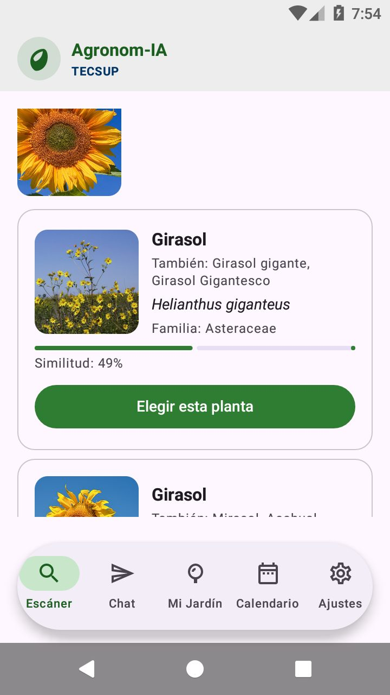

# Agronom-IA

Asistente botánico para agricultores: se sube una foto de una planta, se
identifica la especie y se devuelve una **ficha clara en español** (luz, riego,
suelo, clima, floración, usos y cuidados) con glosario y materiales. Después se
puede **conversar** con un asistente que conoce la planta detectada.

El trabajo pesado (Pl@ntNet + Gemini con *skills*) lo hace el **backend de
usuario en Spring Boot**; la app m?vil y la web de usuario env?an fotos y
mensajes a ese servicio. El **panel de administraci?n** lo atiende Django,
que comparte la misma base de datos MySQL.

## Arquitectura

```
   App Android ----->                        \
   (Kotlin/Compose)   Spring Boot (usuario)   +--> Pl@ntNet
                     :8081 identifica, ficha,  +--> Gemini (skills)
   Web de usuario --> chat, horario           /
   (React) :5174    /
                    \________________________ MySQL (XAMPP) :3306
                                              base `agronomia`
                    /------------------------
   Panel admin ---->  Django (admin) :8000
   (React) :5173      /api/admin/*, usuarios, plantas, chat
```

- **App Android** (`App movil/app/`): Kotlin + Jetpack Compose, paquete
  `com.agronomia`. Inicio de sesión, escáner, ficha y chat; Mi Jardín y
  Calendario. El horario semanal se importa desde el PDF oficial, se revisa en
  el móvil y se guarda por usuario en MySQL. Spring Boot atiende autenticaci?n, identificaci?n, chat y horario/plan de
  cuidados para usuario/web/m?vil.
- **Backend Spring Boot** (`backend-spring/`): API del usuario/web/m?vil.
  Ejecuta identificaci?n, chat y horario/plan de cuidados, y carga las
  *skills* desde `backend-django/skills/`.
- **Backend Django** (`backend-django/`): API del panel de administraci?n
  (`/api/admin/*`) y Django Admin. Comparte la misma base MySQL.
- **Web de usuario** (`web-user/`): React. Escáner, ficha, glosario, jardín y
  conversaciones persistentes por planta.
- **Panel de administración** (`web-admin/`): React. Resumen, usuarios, plantas
  y chat.

### Puertos

| Servicio | URL |
|---|---|
| Spring Boot (usuario/app) | http://127.0.0.1:8081 |
| Django (admin) | http://127.0.0.1:8000 |
| Web de usuario | http://localhost:5174 |
| Panel de administración | http://localhost:5173 |
| MySQL (XAMPP) | 127.0.0.1:3306 |

### Capturas de la app móvil

| Escáner | Especies parecidas | Ficha |
|---|---|---|
|  |  |  |

## Puesta en marcha

### Inicio rápido para la demo

Con MySQL, las dependencias de Python/Node y el jar de Spring ya instalados:

```powershell
powershell -ExecutionPolicy Bypass -File scripts\iniciar-demo.ps1 -ConEmulador
```

Arranca en orden MySQL -> Spring -> Django -> webs -> emulador, respeta lo que ya
esté corriendo y al final ejecuta `check-servicios.ps1`. Sin emulador, omite
`-ConEmulador`. Cada servicio queda en su propia ventana: no las cierres
durante la demo.

**Recorrido sugerido:** identificación clara → ficha; foto con dudas →
candidatas → ficha; imagen sin planta → guía; abre Chat para escoger una planta
y continuar su conversación desde la web o el móvil; y panel de administración
con los datos compartidos. Las cuentas están más abajo.

Los pasos detallados de instalación siguen a continuación.

### 1. Base de datos

1. Abre XAMPP y arranca **MySQL**.
2. Crea la base y el usuario con `docs/sql/agronomia.sql` (o phpMyAdmin).
3. Las tablas las crea Django con `migrate`; `plant_images` ya existe en el
   esquema original y se mantiene.

### 2. Backend Spring Boot (servicio de usuario/web/m?vil)

```powershell
cd backend-spring
# configura .env/vars: DB_*, PLANTNET_API_KEY, AI_*, SCHEDULE_INTERNAL_TOKEN
.\mvnw.cmd -q -DskipTests package
java -jar target/agronomia-backend-0.1.0-SNAPSHOT.jar
```

Expone `/agronomia-api/api/*` en `http://127.0.0.1:8081`.

Detalle: [`backend-spring/README.md`](backend-spring/README.md).

### 3. Backend Django (panel admin)

```powershell
cd backend-django
py -m pip install -r requirements.txt
Copy-Item .env.example .env
C:\xampp\mysql\bin\mysql.exe -u root < ..\docs\sql\agronomia.sql
py manage.py migrate
py manage.py seed_demo         # admin/Admin12345 y agricultor/Campo12345
py manage.py runserver 127.0.0.1:8000
```

Expone `/api/admin/*` en `http://127.0.0.1:8000`.

Detalle: [`backend-django/README.md`](backend-django/README.md).

### 4. Webs

```powershell
cd web-user ; npm install ; npm run dev    # http://localhost:5174
cd web-admin; npm install ; npm run dev    # http://localhost:5173
```

Detalle: [`web-user/README.md`](web-user/README.md) y
[`web-admin/README.md`](web-admin/README.md).

### 5. App Android

Abre la carpeta `App movil/` en Android Studio. Crea allí `local.properties`
con la ruta del SDK y la URL del backend:

```properties
sdk.dir=C\:\\Android\\Sdk
BACKEND_BASE_URL=http://10.0.2.2:8081/
```

Luego ejecuta `App movil\gradlew.bat installDebug`. El emulador llega al PC
con `10.0.2.2`. Consulta [`App movil/README.md`](<App movil/README.md>) para
los detalles.

## Cuentas de demo

Se crean con `py manage.py seed_demo` (solo desarrollo):

| Usuario | Contraseña | Rol | Entra en |
|---|---|---|---|
| `admin` | `Admin12345` | admin | panel de administración |
| `agricultor` | `Campo12345` | user | app móvil y web de usuario |

El panel rechaza las cuentas con rol `user` (403) y el backend de usuario no
deja que un usuario se asigne el rol `admin` al registrarse.

## Cómo funciona la identificación

1. **Pl@ntNet** devuelve la especie y su ficha. La confianza decide el caso:
   - `< 20 %` → no identificada: se explica y se dan consejos de foto.
   - `20 – 49 %` → ambigua: se muestran las candidatas; al elegir una, se
     genera la ficha reutilizando la corrida de Pl@ntNet.
   - `≥ 50 %` → identificada: se genera la ficha directamente.
2. **Gemini** trabaja con las *skills* de `backend-django/skills/`
   (refinar consulta, una por categoría, glosario y materiales). Se hacen 4
   llamadas en lote con reintento ante 429 y ante JSON inválido. Si no conoce
   la especie, la ficha no se inventa: se avisa con el estado `insufficient`;
   si solo falta una categoría, se muestra un texto de respaldo con pautas
   generales.
3. El **chat** recibe el contexto de la planta (nombre, familia, similitud) y
   responde en español con formato Markdown.

## Documentación

- [`docs/BASE-DATOS.md`](docs/BASE-DATOS.md): tablas y relaciones de usuarios,
  fotos, identificaciones y chat.
- [`docs/CONFIG-IA.md`](docs/CONFIG-IA.md): pipeline de IA y skills.
- [`docs/HU-07.md`](docs/HU-07.md): trazabilidad de la historia de cuidado de
  la planta (tareas del sprint, estados y pruebas).
- [`docs/sql/agronomia.sql`](docs/sql/agronomia.sql): base de datos compartida.
- [`backend-django/README.md`](backend-django/README.md): endpoints del usuario.
- [`backend-spring/README.md`](backend-spring/README.md): endpoints del admin.
- [`web-user/README.md`](web-user/README.md) y
  [`web-admin/README.md`](web-admin/README.md): las dos webs.

## Seguridad

- Ninguna clave vive en el repositorio: Django usa `backend-django/.env`
  (ignorado por Git). `App movil/local.properties.example` y `.env.example` solo muestran
  los nombres de las variables.
- La app Android **no lleva claves**: solo conoce la URL de Django, que es
  quien habla con Pl@ntNet y Gemini.
- El servicio de administración usa un token HMAC firmado (8 h por defecto) y
  comprueba el rol en cada petición.
- El login de usuario emite un token firmado de 14 días. Django lo verifica en
  las rutas de fotos, identificación y chat y almacena `user_id` en MySQL.
- El autorregistro crea siempre cuentas con rol `user`; el rol `admin` solo se
  asigna desde el servidor.
- Comentarios del código, mensajes de interfaz y documentación en español.

## Estado

Funcionando de punta a punta sobre MySQL/XAMPP: app móvil, web de usuario,
backend Django, backend Spring y panel de administración. Las pruebas se
hicieron con fotos de girasol (identificada), una foto recortada (ambigua con
candidatas) y una imagen gris (no identificada).
