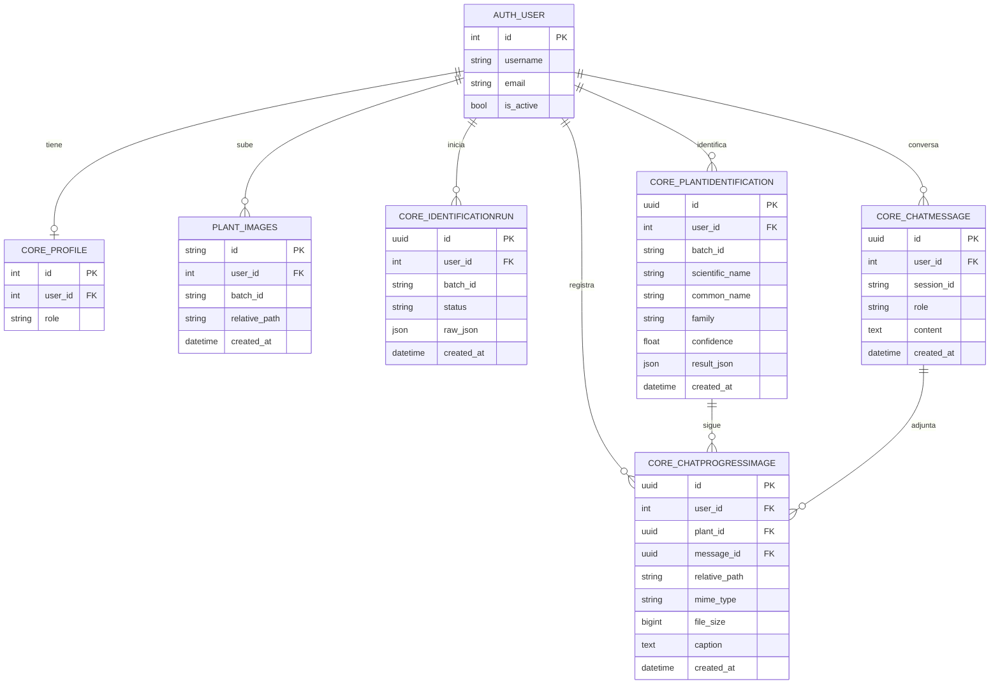

# Estructura de la base de datos

Agronom-IA usa la base MySQL `agronomia`. Django crea y gestiona las tablas de
usuarios, identificaciones y chat; Spring Boot las consulta para el panel de
administración. `plant_images` es una tabla heredada que Django conserva y
amplía mediante migraciones.



Las columnas `user_id` admiten `NULL` para conservar los registros que ya
existían antes de asociar cada operación a una cuenta. Las operaciones nuevas
requieren iniciar sesión y guardan el usuario autenticado en esas relaciones.
Si se elimina una cuenta, sus registros se conservan y quedan sin usuario.

El chat usa un `session_id` estable derivado del UUID de cada identificación.
Así, cada planta identificada tiene su propia conversación y el usuario puede
retomarla desde la web o el móvil. El historial se consulta siempre por
`user_id` y `session_id`, de modo que dos cuentas nunca comparten mensajes.

Las fotos de progreso pertenecen a una planta y a un mensaje de su conversación.
La base conserva su ruta, tipo, tamaño y descripción; el archivo se guarda en
`PLANT_UPLOAD_DIR`. La galería del móvil filtra por la identificación de la
planta y no mezcla las fotos iniciales del escáner con las fotos de progreso.

Al actualizar una base ya creada, aplica las migraciones después de iniciar
MySQL:

```powershell
cd backend-django
py manage.py migrate
```
